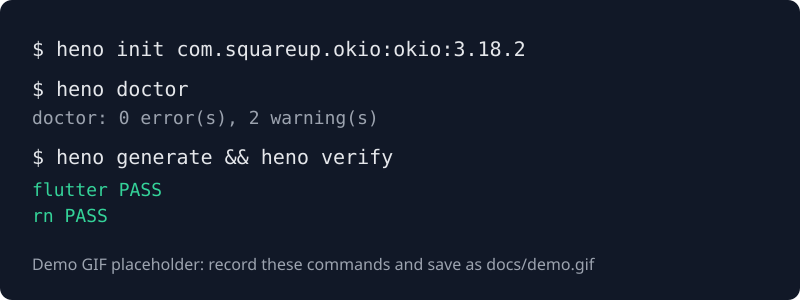

# Henosis

**One source. Every platform.**

Henosis (Greek ἕνωσις, "oneness") turns a native **Android SDK** (an `.aar` file or Maven
coordinates) plus one small config file into ready-to-run cross-platform packages:

- a **Flutter plugin** (Dart API, Android plugin glue, example app)
- a **React Native module** (New Architecture TurboModule, TypeScript API, example app)

One config, one command (`heno`), no hand edits.



> Demo placeholder. The real recording (`docs/demo.gif`) shows the commands in the **60-second
> tour** below taking an SDK from `.aar` to two building packages.

## 60-second tour

Prerequisites: JDK 17+, the Android SDK with `ANDROID_HOME` set (platform 36 and build-tools 36.0.0
for the sample SDK). Flutter 3.47+ and Node 22+ (with Corepack) are only needed by `heno verify`
for the target you want to build.

```bash
git clone https://github.com/devstrike/henosis.git && cd henosis
```

```bash
./gradlew :henosis-cli:installDist && export PATH="$PWD/henosis-cli/build/install/heno/bin:$PATH"
```

That builds `heno` and the sample SDK shipped in `fixtures/sample-sdk`. Now generate both packages
from the sample config and build their example apps:

```bash
heno generate -c fixtures/henosis.yaml --out henosis-out
```

```bash
heno verify -c fixtures/henosis.yaml --out henosis-out
```

```
flutter  PASS
rn       PASS
verify: 2/2 target(s) passed
```

The Flutter plugin is in `henosis-out/flutter/sample_sdk/`, the React Native package in
`henosis-out/react-native/sample-sdk/`, each with an `example/` app that calls every binding.

## Your own SDK

1. **Inspect** what Henosis can bind. Every public member is tagged `ok`, `warn` or `unsupported`
   with a reason:

   ```bash
   heno inspect path/to/your-sdk.aar
   ```

2. **Init** a starter config with every class listed and commented out. Maven coordinates work too:

   ```bash
   heno init path/to/your-sdk.aar
   ```

   ```bash
   heno init com.squareup.okio:okio:3.18.2
   ```

3. **Select** the classes and methods you want to expose in `henosis.yaml`
   ([reference](docs/config.md)). Signatures come from the SDK; the config only picks members.

4. **Doctor, generate, verify.** `doctor` prints one line per problem with a fix hint and exits 1
   on any error; `generate` runs it first.

   ```bash
   heno doctor && heno generate && heno verify
   ```

Three public SDKs (Okio, osmdroid, ZXing) go through this loop with zero hand edits; see
[docs/compatibility.md](docs/compatibility.md) for what binds, what does not, and why.

## Install a release

Each release ships `heno-<version>.zip` with launcher scripts; it needs only a JDK 17+:

```bash
unzip heno-0.1.0.zip && ./heno-0.1.0/bin/heno --version
```

## How it works

```
.aar / Maven ──► Parser ──► Facade selection + doctor ──► IR (JSON)
                                                          │
                     ┌────────────────────┬───────────────┼────────────────────┐
                     ▼                    ▼               ▼                    ▼
              Kotlin bridge        Flutter target   React Native target   (MAUI, v0.2)
                     └────────────────────┴───────────────┴──► heno verify (builds example apps)
```

- **Facade-first.** You list the classes and methods to expose; Henosis reads their real
  signatures from bytecode and Kotlin metadata (nullability, `suspend`, data classes, enums).
- **One IR.** Every target generator reads only the intermediate representation
  ([schema](docs/ir.schema.json)). A new framework is a new generator, not a new tool.
- **Deterministic.** Same input, byte-identical output, no timestamps. Every generated file starts
  with `Generated by Henosis <version>. Do not edit.`
- **Fails loudly.** Unsupported types never silently vanish; `doctor` names the member and the fix.

What crosses the bridge: `Int`, `Long`, `Double`, `Float`, `Short`, `Byte`, `Boolean`, `String`,
nullable types, `List<T>`, `Map<String, T>`, `ByteArray`, data classes, enums, `suspend` functions
(`Future` / `Promise`), `Flow<T>` events (`Stream` / `addListener`) and exceptions
(`HenosisException(code, message)` / `HenosisError`). The full table is in
[docs/type-mapping.md](docs/type-mapping.md); what is deliberately out of v0.1 is in
[docs/roadmap.md](docs/roadmap.md).

## Commands

| Command | Behaviour |
| --- | --- |
| `heno init <aar-or-coords> [--repo url] [--out henosis.yaml]` | Parse the SDK and write a starter config with every public class commented out |
| `heno inspect [sdk] [--json]` | Print the public API tree; each member tagged `ok`, `warn`, `unsupported` |
| `heno doctor [-c henosis.yaml]` | Validate config and types; exit code 1 on any error |
| `heno generate [--target flutter,rn] [--out dir] [--emit-ir]` | Run doctor, then write the packages (`--emit-ir` also writes `ir.json`) |
| `heno verify [--target flutter,rn] [--out dir] [--flutter bin] [--yarn bin]` | Build every generated example app; pass/fail per target |

Exit codes: `0` ok, `1` validation error, `2` toolchain missing, `3` build failed. Details in
[docs/cli.md](docs/cli.md).

## Documentation

| Document | What it covers |
| --- | --- |
| [docs/cli.md](docs/cli.md) | Every command, option, exit code and environment variable |
| [docs/config.md](docs/config.md) | `henosis.yaml` reference and what `doctor` checks |
| [docs/type-mapping.md](docs/type-mapping.md) | The v0.1 type table and its warnings and errors |
| [docs/architecture.md](docs/architecture.md) | Pipeline, modules, the IR, and how to add a target |
| [docs/ir.schema.json](docs/ir.schema.json) | JSON Schema of the IR written by `generate --emit-ir` |
| [docs/compatibility.md](docs/compatibility.md) | Public SDKs run through the full loop, with results |
| [docs/roadmap.md](docs/roadmap.md) | Out of scope for v0.1, and lessons recorded while building |

## Status

Henosis is pre-release (v0.1.0). Android input only; Flutter and React Native targets; Android
example apps. iOS input and the .NET MAUI target are on the roadmap.

| Milestone | Scope | Status |
| --- | --- | --- |
| M1 | Gradle multi-module skeleton, sample SDK fixture, `heno --version`, `heno inspect` with golden test | ✅ |
| M2 | `henosis.yaml` config, IR + JSON schema, `heno init`, `heno doctor`, `generate --emit-ir` | ✅ |
| M3 | Kotlin bridge + Flutter target (plugin + example app) | ✅ |
| M4 | React Native target (TurboModule + example app) | ✅ |
| M5 | `heno verify`, Maven input, exception mapping, 3 public SDKs in `docs/compatibility.md` | ✅ |
| M6 | Launch readiness: quickstart, docs, contributing guide, release workflow | ✅ |

## Contributing

Bug reports, SDK compatibility reports and pull requests are welcome; start with
[CONTRIBUTING.md](CONTRIBUTING.md). Henosis is a clean-room project: no code, assets or internal
knowledge from any employer or client, only our own sample SDK and public open-source SDKs.

## License

Apache-2.0. See [LICENSE](LICENSE) and [NOTICE](NOTICE). © Devstrike Digital Limited, Abuja.
